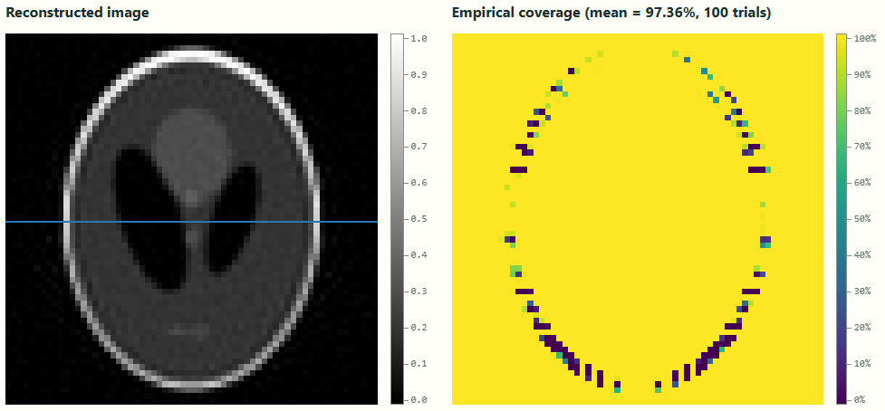

# Uncertainty Quantification in CT Reconstruction

An interactive app for drawing an image, simulating a CT scan, and reconstructing it with Landweber iteration. Explore pixelwise confidence intervals and check their coverage across repeated noisy measurements.

Read the [project blog post](https://jonathanwidarsa.com/blog/uncertainty-quantification-for-ct-reconstruction/) for the mathematics, experiments, and limitations.



## Features

- Draw with a brush, eraser, or circle, or load one of five example images, including the modified Shepp–Logan phantom.
- Choose a 16×16, 32×32, 64×64, or 128×128 image grid.
- Generate noiseless and noisy sinograms with configurable acquisition settings.
- Reconstruct using automatic stopping or a fixed iteration count.
- Inspect the reconstruction, confidence intervals along a selected row, and empirical coverage across validation trials.

## Quick start

Requires **Python 3.11+**. On Linux or macOS:

```sh
python3 -m venv .venv
.venv/bin/python -m pip install -r requirements.txt
.venv/bin/python app.py
```

Open **http://127.0.0.1:5000**. To use another port, append `--port 5010` to the last command.

The app runs locally with Flask and a JavaScript interface. MATLAB, Node.js, API keys, and a frontend build are not required to run it.

## Workflow

1. **Draw:** create or load an image, choose its resolution, and click **Freeze image**.
2. **Measure:** configure the scan and noise, then click **Generate scan**.
3. **Reconstruct:** choose the settings and click **Prepare reconstruction**, then **Calculate & validate**.
4. **Inspect:** view the reconstructed image, coverage map, and row-wise confidence intervals.

Start with the default 16×16 grid; larger images can require substantial time and memory. Progress and cancellation are available under **Numerical jobs**.

Records are stored in memory and disappear when the server stops. Run one server process.

## Main defaults

For size-dependent settings below, values correspond to **16×16 / 32×32 / 64×64 / 128×128** grids.

| Setting | Default |
|---|---|
| Image resolution | 16×16 |
| Projection angles | 180 equally spaced over 0°–180°, excluding 180° |
| Detector count | 27 / 49 / 95 / 185 |
| Gaussian noise SD (σ) | 0.1 |
| Measurement seed | 0 |
| Stopping mode | Automatic bias–noise crossing |
| Maximum iterations | 1500 |
| Fixed iterations, when selected | 500 |
| Source exponent (ν) | 0.5 |
| Source bound (M) | Calibrated from the drawing; optional manual override |
| Retained rank (r) | 32 / 64 / 128 / 256 |
| Oversampling (p) | 10 |
| Residual probes (N) | 100 |
| Residual tolerance (ε) | 0 |
| Gaussian tail probability (α) | 0.05 |
| Validation trials | 100 |

To skip source calibration, uncheck **Calibrate M from drawing** before generating a scan and enter a **Manual source bound (M)** in reconstruction settings. A manual value overrides calibration.

This is an experimental project. Nominal confidence levels and high average coverage do not guarantee reliable intervals for every pixel; see the blog post for the observed limitations.

## Tests

Python:

```sh
.venv/bin/python -m unittest discover -s tests
```

JavaScript (requires Node.js and npm):

```sh
npm ci
npm test
```
